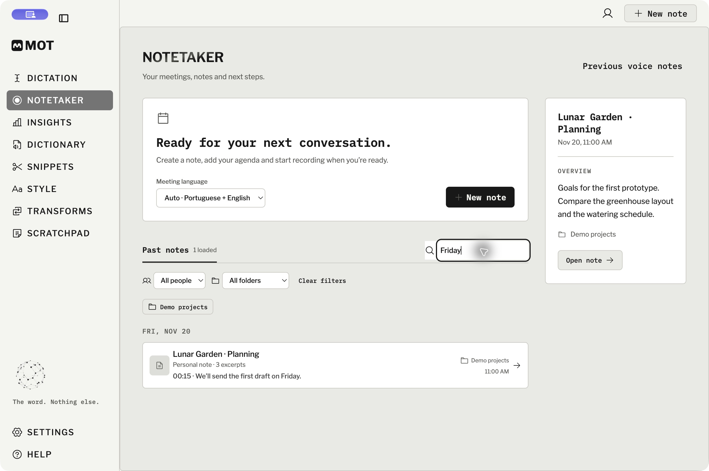
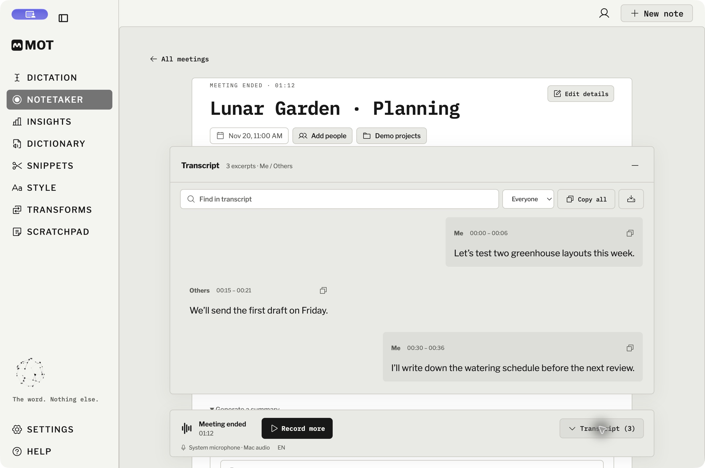
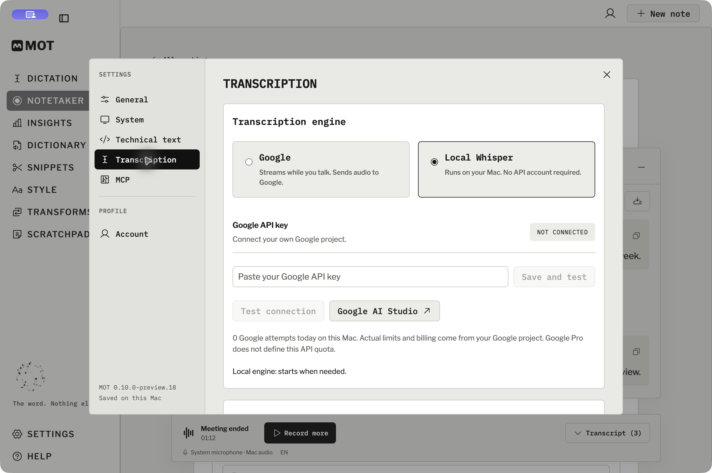
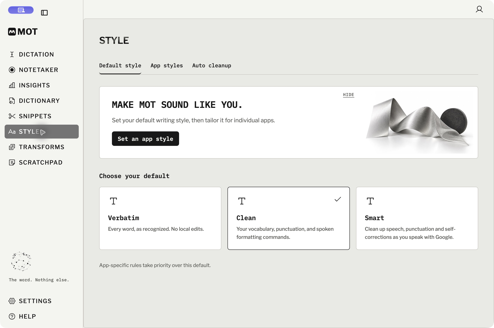
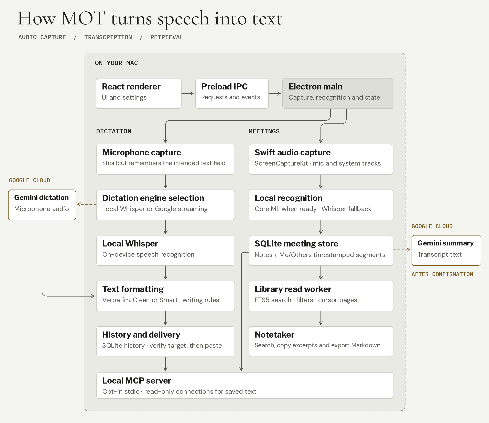

<p align="center">
  
</p>
<h1 align="center">MOT</h1>
<p align="center"><strong>Say it. Find it later.</strong></p>
<p align="center">Voice dictation and searchable meeting transcripts for macOS.</p>
<p align="center">
  
  
  
  
  
  
  
</p>
<p align="center"><a href="#see-it-in-action">See it in action</a> · <a href="#transcription-engines">Engines</a> · <a href="#architecture">Architecture</a> · <a href="docs/workflows.md">Walkthrough</a> · <a href="docs/blueprint.md">Blueprint</a></p>
<p align="center">
  
</p>

## See it in action

MOT handles two jobs. Dictate into the app you're already using, or record a meeting and come back to the exact words later. The screens below come from MOT with fictional demo data.

### Dictate into the app you already have open

Hold the shortcut, speak, and release. MOT transcribes your speech and pastes it into the original text field when it still has focus. If you switch windows, open Dictation and copy the result from your history.


### Record meetings and search the library

Start a note, write an agenda, and record. The Mac's system audio and your microphone are kept on separate tracks. The library searches across saved meeting notes and transcripts, with filters for people and folders.


In the demo, searching for `Friday` returns the matching excerpt at `00:15`.



### Find the line, then take it with you

Within a meeting, search the transcript or filter it by **Me** and **Others**. Copy an excerpt or export the transcript as Markdown. The separate full meeting export saves a JSON record with notes, transcript, and any saved summary.



## Transcription engines

| Workflow | Engine | Where the data goes |
| --- | --- | --- |
| Dictation · Local Whisper | Runs on the Mac with an available Whisper model. | Speech recognition stays on the Mac. |
| Dictation · Google | Streams audio to Google's Gemini API using your own API key. | Google receives audio for recognition. Your Google project determines quota and billing. |
| Meeting transcription | Runs locally. The preview can use a Core ML recognizer for live drafts when its model is ready, with Whisper available for final transcription. | Meeting audio stays on the Mac for transcription. |
| Meeting summary · optional | A separate request uses Google's Gemini API. | Google receives transcript text when you explicitly confirm the summary request. |

Choose **Google** or **Local Whisper** in **Settings → Transcription**. Dictation engine selection and meeting transcription are separate. Optional Google grammar review in Smart dictation is also a separate request.



## Writing tools

| Tool | What it's for |
| --- | --- |
| Dictionary | Add preferred spellings and exact substitutions for terms you dictate. |
| Snippets | Expand a spoken shortcut into reusable text. |
| Style | Choose Verbatim, Clean, or Smart formatting for dictation. |
| Technical text | Keep recognition closer to the literal wording in supported terminal apps. |
| Transforms | Reformat existing text on the Mac. |
| Scratchpad | Keep drafts and microphone voice notes. |
| Insights | Review dictation speed and usage from local history. |



[Walk through capture, search, export and recovery →](docs/workflows.md)

## Architecture

<picture>
  <source media="(prefers-color-scheme: dark)" srcset="assets/mot-architecture-dark.png">
  
</picture>

[Full-size dark diagram](assets/mot-architecture-dark.png) · [Full-size light diagram](assets/mot-architecture-light.png) · [Editable Excalidraw source](docs/mot-architecture.excalidraw)

- **Desktop and capture.** Electron and React render the app. The Electron main process coordinates capture, engine selection, persistence, and delivery. Swift helpers provide native macOS integration, including meeting audio capture via ScreenCaptureKit.
- **Meeting storage and search.** The local SQLite store keeps notes and timestamped transcript segments. An FTS5 index supports library queries. Separate read workers keep search and history queries off the main process.
- **Text delivery.** Dictation checks the destination before pasting. The result stays in history for manual copy when the app cannot safely return text to the original field.

### Architecture as pseudocode

These examples describe the control flow. For the runtime boundaries, data handling, and a sequence diagram, see the [architecture notes](docs/architecture.md).

```python
def finish_dictation(session):
    if session.engine == "google":
        draft = session.google_stream.finish()
    else:
        draft = whisper.transcribe(session.audio)

    text = apply_selected_style(draft, session)
    history.save(text)
    if session.started_from_shortcut and destination_is_still_focused(session.target):
        paste_into_original_field(text, session.target)


def finish_meeting(recording):
    segments = []
    for track in recording.microphone_and_system_tracks:
        segments.extend(transcribe_on_device(track))
    transcript = order_by_timestamp(segments)
    library.save(recording.notes, transcript)
    return transcript
```

[Read the product blueprint →](docs/blueprint.md)

## For MCP clients

The private preview includes a local, opt-in MCP server over standard input and output. Connected clients can search saved dictations, list meetings, and read the chosen transcript or saved summary. See the [read-only tool flow](docs/architecture.md#local-mcp-interface).

## Availability

MOT is in private preview for Apple silicon. Meeting recording requires macOS 15 or later and the corresponding macOS capture permissions. This repository documents the app and its design.

| Document | Contents |
| --- | --- |
| [Walkthrough](docs/workflows.md) | Dictation, meeting search, writing tools and troubleshooting |
| [Architecture](docs/architecture.md) | Runtime boundaries, storage, cloud requests and MCP |
| [Blueprint](docs/blueprint.md) | User flows, design decisions and preview status |

